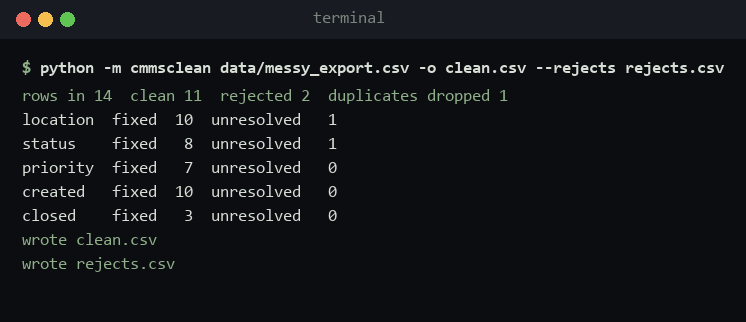

# cmms-export-cleaner

[](https://github.com/yassine2med/cmms-export-cleaner/actions/workflows/ci.yml)  

Normalizes a messy CMMS CSV export into a clean file plus a file of rejected rows.



## What it is for

CMMS exports (from the system a facility team uses to track maintenance requests) are rarely consistent. One request says "Bldg A Rm 101", the next says "BLDG-A / 102", dates arrive as `03/04/2026`, `5-Mar-2026` and `March 6, 2026`, and status text mixes "WIP", "done" and "Canceled". Reports built on that data count the same thing three ways. A facility coordinator, maintenance planner or data analyst runs this tool before reporting or migrating data. It maps the column names, normalizes the values, drops duplicate work order ids, and writes a clean file plus a separate file for rows it cannot trust. The sample data is synthetic.

## Install

```
git clone <this repository> && cd cmms-export-cleaner
python -m pip install -e .
```

No third-party packages are needed.

## How to use

| I want to | Command |
| --- | --- |
| Clean an export (writes `clean.csv` and `rejects.csv` in the current folder) | `python -m cmmsclean data/messy_export.csv` |
| Choose the clean output file name (default `clean.csv`) | `python -m cmmsclean data/messy_export.csv -o out.csv` |
| Choose the rejected rows file name (default `rejects.csv`) | `python -m cmmsclean data/messy_export.csv --rejects bad.csv` |
| See all options | `python -m cmmsclean --help` |

`rejects.csv` holds the rows with no id or an unreadable created date, with a `reason` column. It is only written when there are rejected rows.

Worked example:

```
python -m cmmsclean data/messy_export.csv -o clean.csv --rejects rejects.csv
```

Output:

```
rows in 14  clean 11  rejected 2  duplicates dropped 1
location  fixed  10  unresolved   1
status    fixed   8  unresolved   1
priority  fixed   7  unresolved   0
created   fixed  10  unresolved   0
closed    fixed   3  unresolved   0
wrote clean.csv
wrote rejects.csv
```

First lines of `clean.csv`:

```
id,location,status,priority,created,closed,description
WO-2001,"Building A, Room 101",Open,High,2026-03-04,,Thermostat not responding
WO-2002,"Building A, Room 102",In Progress,Emergency,2026-03-05,,No cooling in server closet
WO-2003,"Building B, Room 210",Closed,Medium,2026-03-05,2026-03-09,Leaking faucet
```

First lines of `clean.csv`:

```
id,location,status,priority,created,closed,description
WO-2001,"Building A, Room 101",Open,High,2026-03-04,,Thermostat not responding
WO-2002,"Building A, Room 102",In Progress,Emergency,2026-03-05,,No cooling in server closet
WO-2003,"Building B, Room 210",Closed,Medium,2026-03-05,2026-03-09,Leaking faucet
```

## How it works

- Header names are matched to seven fields (id, location, status, priority, created, closed, description) through an alias table, so `WO #` and `Date Opened` are recognised. The file must have an id and a created column.
- Dates are tried against ten formats and written as `YYYY-MM-DD`. Slash dates are read month first. If the first number is above 12 the date is read day first. A time of day is dropped.
- Status words map to Open, In Progress, On Hold, Closed or Cancelled. Priority words and codes (P1, urgent, routine) map to Emergency, High, Medium or Low.
- Locations that match a building pattern become `Building A, Room 101` or `Annex D, Room 2`.
- A value the rules do not know is kept as it was and counted as unresolved. Nothing is guessed.
- The first row for each id is kept. Ids are compared without regard to case.

## Limits

- The alias tables and word lists are English and cover only the words in `src/cmmsclean/rules.py`. Add your own words there.
- A date like `03/04/2026` is always read as March 4. Day-first exports of that kind need a code change.
- Only building and room patterns are recognised. Floors, zones and equipment tags stay as they are.
- It reads the whole file into memory.

## License

MIT. Yassine Emhamed, 2026.
